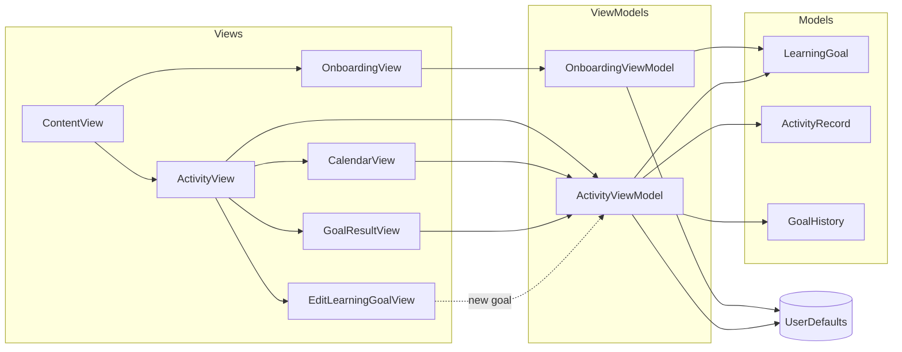

[README.md](https://github.com/user-attachments/files/35018026/README.md)
<p align="center">
  
</p>

<p align="center">
  
  
  
  
</p>

<p align="center">
  <a href="#-overview">Overview</a> ·
  <a href="#-screenshots">Screenshots</a> ·
  <a href="#-how-it-works">How It Works</a> ·
  <a href="#-architecture">Architecture</a> ·
  <a href="#-getting-started">Getting Started</a> ·
  <a href="#-roadmap">Roadmap</a>
</p>

---

##  Overview

**LearningTracker** helps you stay consistent with something you want to learn: Swift, piano, drawing, a new language, anything.

Pick **one goal**, commit for a **week, a month, or a year**, and check in every day. Learned today? Log it. Need a break? **Freeze** the day and keep your streak alive. When the goal ends, the app tells you whether you made it.

> **Consistency without pressure.** Missing one day shouldn't feel like losing everything.

---

##  Screenshots

<table>
  <tr>
    <td></td>
    <td></td>
    <td></td>
  </tr>
  <tr>
    <td></td>
    <td></td>
    <td></td>
  </tr>
</table>

<!-- Demo video: save a screen recording as Screenshots/demo.gif and add:
<p align="center"></p>
-->

---

##  Features

| | Feature | |
|:---:|---|---|
| 🎯 | **One clear goal** | Choose a subject and commit for a week, a month, or a year. |
| 🔥 | **Daily check-in** | Log today as **Learned** with one tap. |
| ❄️ | **Freeze days** | Take a break without breaking your streak (2 / 8 / 96 per goal). |
| 📊 | **Progress at a glance** | This week's days, plus your learned and frozen counts. |
| 🗓️ | **Activity calendar** | Every learned and frozen day, including past goals. Tap a day for details. |
| 🏁 | **Goal results** | A clear success or try-again screen when the goal period ends. |
| ✏️ | **Flexible goals** | Change your goal anytime. The old one is archived, not deleted. |
| 💾 | **Always saved** | Your goal, activity, and history stay saved when you close the app. |

---

## How It Works

### 1. Set a goal

Type what you want to learn and choose a duration. The goal starts at **12:00 AM on the day you create it** and ends on a real calendar date.

| Duration | Goal period | Example (starts Nov 18) | Freezes |
|---|---|---|:---:|
| **Week** | 7 days | Nov 18 – Nov 24 | 2 |
| **Month** | 1 calendar month | Nov 18 – Dec 17 | 8 |
| **Year** | 1 calendar year | Nov 18 – Nov 17 next year | 96 |

### 2. Check in once a day

| Button | Result |
|---|---|
| **Log as Learned** | Today is saved as `learned` and the **Learned** count goes up. |
| **Freeze for a day** | Today is saved as `frozen`, the **Freezed** count goes up, and one freeze is used. |

- **One activity per day:** after either action, both buttons lock for the rest of the day.
- **Midnight unlock:** the buttons unlock again at **12:00 AM**. The app re-checks every minute and when you return to it.
- **Freeze limit:** **Freeze for a day** is disabled once all freezes for the goal are used.
- **After the goal ends:** logging and freezing stop.

### 3. Keep your streak

Learned **and** frozen days both keep your streak going, as long as **no more than 32 hours** pass between one activity and the next.

```text
Mon 8 PM  🔥 Learned
               │  24h ✓
Tue 8 PM  ❄️ Frozen
               │  26h ✓
Wed 10 PM 🔥 Learned        →  streak = 3
```

The streak resets to **0** if more than 32 hours pass, or when you update your goal.

### 4. Finish the goal

When the goal period ends, the home screen shows your result:

- ✅ **Well done!** You logged **Learned** on **every** day of the goal.
- ❌ **You didn't reach your goal this time.** At least one day wasn't learned.

> **Frozen days protect your streak, but they don't count as learned days.**
> For a week: 7 learned = ✅ · 6 learned + 1 frozen = ❌

Tap **Set a goal** to start the next one.

### 5. Change your goal

Tap ✏️, change the subject or duration, and confirm **Update**. The app archives the current goal with all its days, then starts a fresh one from today with a new streak, counts, and freezes. If nothing changed, nothing is reset.

---

## 🏗️ Architecture

LearningTracker uses **MVVM**: views draw the screens, view models hold the logic, and models describe the data.



| Layer | Responsibility |
|---|---|
| **Models** | Plain data: `LearningGoal`, `ActivityRecord` (+ `ActivityStatus`), `GoalHistory` |
| **ViewModels** | `ActivityViewModel` handles logging, freezes, the streak, goal dates, completion, archiving, and saving. `OnboardingViewModel` builds and saves the first goal. |
| **Views** | Display data and pass taps to the view models. No business rules. |

<details>
<summary><b>📂 Project structure</b></summary>

```text
LearningTracker/
├── LearningTracker.xcodeproj
├── Screenshots/
└── LearningTracker/
    ├── LearningTrackerApp.swift      # App entry (dark mode)
    ├── ContentView.swift             # Onboarding or Activity
    ├── Models/
    │   ├── LearningGoal.swift        # Subject + duration
    │   ├── ActivityRecord.swift      # One learned / frozen day
    │   ├── GoalHistory.swift         # An archived goal
    │   └── DebugPanel.swift          # Debug-only testing panel
    ├── ViewModels/
    │   ├── ActivityViewModel.swift   # Core app logic
    │   └── OnboardingViewModel.swift # Goal form + first save
    ├── Views/
    │   ├── OnboardingView.swift
    │   ├── ActivityView.swift        # Home screen
    │   ├── CalendarView.swift
    │   ├── EditLearningGoalView.swift
    │   ├── GoalResultView.swift
    │   └── Components.swift          # Shared UI pieces
    ├── Assets.xcassets               # apporange, appblue
    └── learning.icon                 # App icon
```

</details>

<details>
<summary><b>🧩 Data models</b></summary>

| Model | Properties |
|---|---|
| `LearningGoal` | `subject: String`, `duration: String` (`"Week"`, `"Month"`, `"Year"`) |
| `ActivityRecord` | `date: Date`, `status: ActivityStatus`, `subject: String?`, `duration: String?`. `Codable` and `Identifiable`; the `id` is the day, e.g. `2026-11-18`. |
| `ActivityStatus` | `.learned`, `.frozen` |
| `GoalHistory` | `id: UUID`, `learningGoal`, `startDate`, `endDate`, `records: [ActivityRecord]` |

</details>

<details>
<summary><b>🎨 Shared UI components</b> (<code>Components.swift</code>)</summary>

| Component | Purpose |
|---|---|
| `ActivityHeader` | **Activity** title, date, and the top-right icons |
| `GlassIcon` | Round glass icon buttons |
| `OrangeButtonLabel` | Orange capsule buttons (**Start Learning**, **Set a goal**) |
| `GoalForm` | Goal text field + Week / Month / Year picker |
| `WeekStripView` / `DayCircle` | This week's days: orange = learned, blue = frozen |
| `StatCard` / `StatCards` | **Learned** and **Freezed** counters |

</details>

<details>
<summary><b>💾 Data persistence</b></summary>

Everything is stored **on the device** in `UserDefaults`. Lists are saved as JSON with `Codable`.

| Key | Stores |
|---|---|
| `learningGoalSubject` / `learningGoalDuration` | The current goal |
| `goalStartDate` | When the current goal started |
| `activityRecords` | The current goal's learned and frozen days |
| `streakResetDate` | When the streak was last reset by a goal update |
| `goalHistory` | All archived goals and their days |

When you update a goal, its records are **moved into `goalHistory`** before the current list is cleared. The calendar shows both.

</details>

<details>
<summary><b>🛠️ Debug panel</b></summary>

Available in **Debug builds only**. Long-press the Activity screen for 1 second to open it.

It has a **simulated clock** (+1 hour, +1 day, +33 hours, jump to the goal's end, reset) and shows live values such as the streak, goal dates, and freezes used. Use it to test streaks, midnight unlocking, and goal results without waiting real days.

</details>

---

## Tech Stack

| | |
|---|---|
| **UI** | SwiftUI with Liquid Glass (`glassEffect`) |
| **Architecture** | MVVM |
| **State** | Combine: `ObservableObject`, `@Published`, `Timer.publish` |
| **Storage** | `UserDefaults` + `Codable` (JSON) |
| **Target** | iOS 27.0+ · iPhone & iPad · Swift 5 language mode |
| **Dependencies** | None. Apple frameworks only. |

---

##  Getting Started

**Requirements:** a Mac with **Xcode 27** or later, and an iOS 27 Simulator or device.

```bash
git clone https://github.com/Fay-26/LearningTracker.git
cd LearningTracker
open LearningTracker.xcodeproj
```

Choose an iPhone Simulator in the Xcode toolbar and press **⌘R**.

> **On a real device:** in **Signing & Capabilities**, select your own **Team**. If Xcode reports a conflict, change the **Bundle Identifier**.

---

## Roadmap

### Known limitations

- The streak is calculated, but it is only shown in the Debug panel, not on the home screen.
- The 32-hour rule uses exact times, so logging early one day and late the next can reset the streak.
- The home week strip shows the **current** goal only. Past goals appear in the calendar.
- The week strip's letters assume weeks start on Sunday.
- The calendar shows months up to **December of the current year**.
- One goal at a time, data stored locally only, dark mode only, and no automated tests.

### Ideas for the future *(not implemented)*

- [ ] Show the streak on the home screen
- [ ] Daily reminder notifications
- [ ] Multiple goals at once
- [ ] A past-goals screen with results
- [ ] iCloud sync and export
- [ ] Home Screen widgets
- [ ] Unit tests for the streak, freeze, and completion logic

---

<p align="center">
  Made with SwiftUI by <a href="https://github.com/Fay-26"><b>Fay Alabdulqader</b></a><br>
  <sub>Learn a little every day 🔥</sub>
</p>


